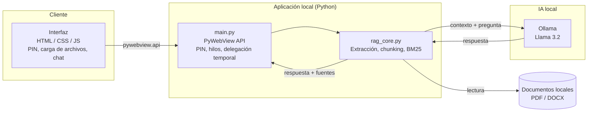

# Vexa Local

Asistente de escritorio para consultar documentos locales con inteligencia artificial, 100% offline.

Proyecto APT (Capstone) — Ingeniería en Informática, Duoc UC.

---

## Descripción

Las organizaciones que manejan documentación sensible (fichas, informes, contratos) necesitan consultarla rápido, pero subirla a servicios en la nube implica riesgo de fuga de datos. Además, leer e indexar archivos pesados una y otra vez genera altas latencias, y no existe un control claro de qué archivos están disponibles para consulta y por cuánto tiempo.

**Vexa Local** resuelve ambos problemas con una aplicación de escritorio que combina:

- Un **motor RAG** (*Retrieval-Augmented Generation*) que extrae el texto de PDF y DOCX, lo fragmenta en *chunks*, lo indexa con **BM25** y entrega al modelo solo los fragmentos relevantes, citando documento y página como fuente.
- Un **LLM local** (Llama 3.2 vía Ollama) que responde únicamente a partir de los documentos cargados, sin inventar información.
- Un **sistema de delegación temporal de archivos**: cada archivo se precarga en memoria y queda disponible por un tiempo definido por el usuario, protegido con **PIN** de acceso (SHA-256 con *salt*).

- **A quién va dirigido:** equipos de trabajo, administradores de sistemas y usuarios finales de organizaciones que requieren control riguroso sobre sus archivos y consulta rápida de documentación sin depender de la nube.
- **Qué problema resuelve:** elimina la latencia de leer/indexar archivos repetidamente y la falta de control documental, manteniendo todos los datos en la máquina del usuario.

---

## Tecnologías utilizadas

| Componente | Tecnología | Por qué |
|---|---|---|
| Lenguaje | **Python 3.10+** | Ecosistema estándar para procesamiento de texto e IA. |
| Interfaz | **PyWebView + HTML5 / CSS3 / JavaScript** | Ventana nativa con interfaz web embebida; permite una UI moderna sin servidor web. |
| LLM local | **Ollama (Llama 3.2)** | Inferencia 100% local, sin enviar datos a servicios externos. |
| Búsqueda | **Rank-BM25** | Recuperación léxica rápida y liviana, sin GPU. |
| Lectura de documentos | **pdfplumber, python-docx** | Extracción de texto (y tablas) de PDF y Word. |
| Empaquetado | **PyInstaller** | Genera un ejecutable `.exe` autocontenido. |

Comunicación entre componentes: la interfaz (JavaScript) llama a Python mediante `pywebview.api`; Python procesa los documentos y consulta a Ollama en `http://localhost:11434`. No se realiza ninguna llamada a servicios externos.

Infraestructura y herramientas de apoyo:
- **Control de versiones:** Git / GitHub (GitFlow: `main`, `develop`, `feature/*`).
- **Seguimiento:** tableros Kanban.

---

## Estructura del repositorio

```
VEXA_LOCAL/
├── Codigo/                 # Código fuente de la aplicación
│   ├── main.py             # Ventana nativa (PyWebView), API y autenticación por PIN
│   ├── rag_core.py         # Motor RAG: extracción, chunking, BM25, prompts, Ollama
│   ├── app.py              # Interfaz alternativa en Tkinter (versión previa)
│   ├── interface.html      # Interfaz web principal
│   ├── static/             # CSS, JavaScript e imágenes de la interfaz
│   ├── tests/              # Pruebas unitarias del motor RAG
│   ├── requirements.txt
│   └── iniciar-vexa.bat    # Atajo para ejecutar en Windows
├── Fase 1/                 # Evidencias de definición del proyecto
├── Fase 2/                 # Evidencias de desarrollo (grupales, ágiles e individuales)
├── .gitignore
└── README.md
```

---

## Instrucciones para ejecutar el proyecto localmente

**Requisitos previos**
- Python 3.10 o superior
- [Ollama](https://ollama.com) instalado
- Git

**1. Clonar el repositorio**
```bash
git clone https://github.com/<organizacion>/VEXA_LOCAL.git
cd VEXA_LOCAL/Codigo
```

**2. Entorno virtual e instalación de dependencias**
```bash
python -m venv venv
source venv/bin/activate   # en Windows: venv\Scripts\activate
pip install -r requirements.txt
```

**3. Ollama y modelo de lenguaje**
```bash
ollama serve               # en una terminal
ollama pull llama3.2:3b    # en una segunda terminal
```

**4. Ejecutar la aplicación**
```bash
python main.py
```
En Windows también se puede usar `iniciar-vexa.bat`, que crea el entorno, instala dependencias y abre la aplicación.

**5. Pruebas**
```bash
pytest tests
```

**6. Generar el ejecutable (opcional)**
```bash
pyinstaller --noconsole --onefile --add-data "interface.html;." --add-data "static;static" main.py
```

**7. Uso**
Al abrir la aplicación por primera vez se crea un **PIN** de acceso. Luego, cargue uno o más documentos (PDF/DOCX), defina por cuánto tiempo estarán disponibles y haga preguntas en el chat: cada respuesta incluye las fuentes (documento y página).

---

## Integrantes del equipo con sus roles

| Integrante | Rol | Responsabilidades principales |
|---|---|---|
| **Hector Schulz** | Jefe de Proyecto & Desarrollador Full-Stack | Planificación y coordinación, ventana nativa con PyWebView, integración frontend–backend, autenticación (PIN con SHA-256), manejo de hilos y empaquetado con PyInstaller. |
| **Ignacio López** | Desarrollador Backend & Especialista en IA / RAG | Motor RAG (BM25), lectura y *chunking* de documentos, integración de Llama 3.2 con Ollama e ingeniería de prompts. |
| **Josué García** | Desarrollador Frontend & Diseñador UX/UI | Diseño visual, flujo del chat, animaciones y estados de error, lógica JavaScript y conexión con la API de PyWebView. |

---

## Metodología de trabajo del equipo

El desarrollo se ejecuta con **Scrum** combinado con prácticas de **DevOps**:

1. Definición del problema, alcance y requerimientos.
2. Diseño de la arquitectura y del flujo de la aplicación.
3. Desarrollo del motor RAG y de la interfaz en paralelo.
4. Integración (PyWebView), pruebas y mejoras.
5. Empaquetado, documentación y preparación de la defensa.

- **Sprints:** iteraciones cortas enfocadas en entregar módulos funcionales.
- **Control de versiones:** GitFlow — `main` (estable), `develop` (integración) y ramas `feature/*`.
- **Seguimiento:** tableros Kanban para asignar responsabilidades, controlar incidencias y monitorear avances.

---

## Arquitectura de la solución

Vexa Local es una arquitectura híbrida y desacoplada: una interfaz web local renderizada por PyWebView y un núcleo Python que procesa documentos y consulta al modelo. Todo ocurre en la máquina del usuario.



**Flujo de datos:**

1. El usuario ingresa su **PIN** y carga documentos desde la interfaz.
2. `main.py` valida el acceso y delega el procesamiento a `rag_core.py` en un hilo aparte para no congelar la ventana.
3. `rag_core.py` extrae el texto por página, lo divide en *chunks* (detectando fichas repetidas como "Cliente N") y construye un índice **BM25** en memoria.
4. Ante una pregunta, se recuperan los fragmentos más relevantes y se arma un *prompt* que obliga al modelo a responder solo con ese contexto.
5. **Ollama** (Llama 3.2) genera la respuesta, que vuelve a la interfaz junto con las fuentes citadas (documento y página).
6. Los archivos activos expiran según el tiempo elegido por el usuario (delegación temporal).
